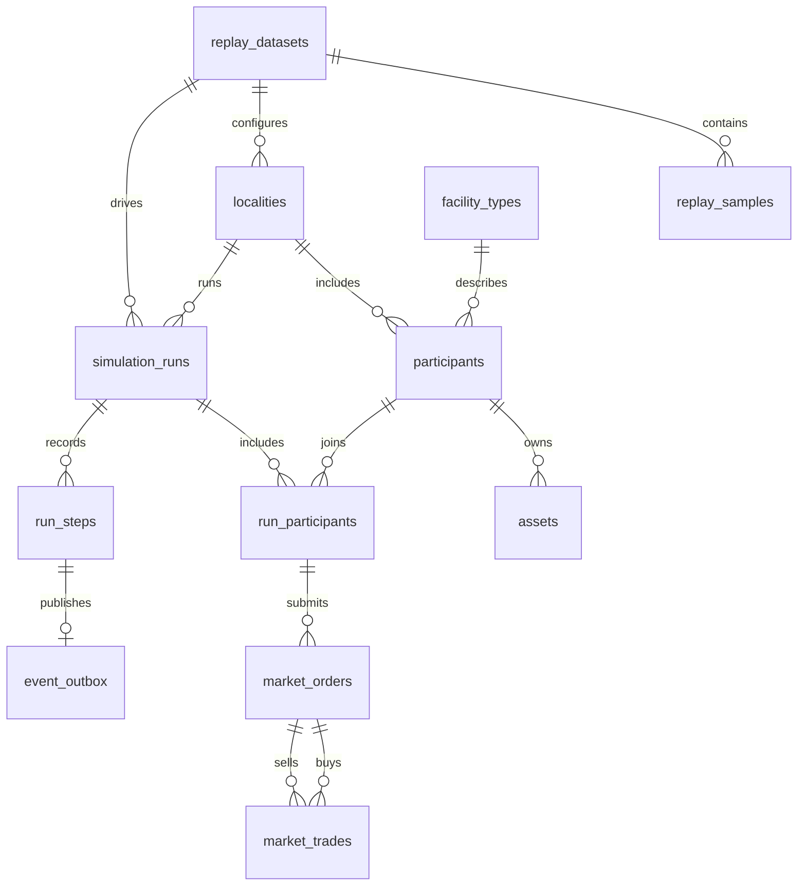

# Database design

Each run belongs to one locality and one imported dataset version. A frozen participant roster and a copy of the run settings make archived runs interpretable after edits to the live registry.



Facility type names live in a lookup table. Participant identities are separate from asset types and ratings. Each asset rating depends on its whole key, `(participant_id, kind)`. Market orders reference the run membership rather than repeating participant names, locality details or ratings. A trade references both orders through the same run and step, with quantity and price as attributes of the trade. Replay and run configuration JSON contain frozen documents for reproducibility. They are outside the 3NF claim for the relational records.

The locality lock and unique active-locality key allow one active worker per locality. Within the run lock, order submission, cancellation and settlement serialize at the step boundary. Settlement validates the order book, writes fills, updates order balances, and records the step and its outbox entry in one SQL transaction. Foreign keys enforce run membership and require both order references to stay within the trade's run and step. Positive quantity and balance checks apply in MySQL. Submitted orders may only be filled within current load and seller supply. SQL uses decimal energy and price fields for orders and trades.

Upon commitment the worker publishes an ordered, keyed document to the local journal. A retry for an already published event must match the existing document. A failed publication leaves a recoverable outbox record and the run cannot claim successful completion with an incomplete event history. Startup attempts to drain those entries. The managed DynamoDB phase will use a run partition key and ordered step sort key for the same event contract.

The API binds to loopback by default and supports a shared local operator key. Database access is scoped to the project schema and uses bound parameters through SQLAlchemy. Locality names, participant details, and run status changes use the audit log. User registration records and measured source data are kept on the machine running the application.

Try these queries in MySQL Workbench after completing a run:

```sql
SELECT l.name AS locality, f.name AS facility_type, p.name, a.kind, a.power_kw
FROM localities AS l
JOIN participants AS p ON p.locality_id = l.id
JOIN facility_types AS f ON f.id = p.facility_type_id
LEFT JOIN assets AS a ON a.participant_id = p.id
WHERE l.active = TRUE AND p.active = TRUE
ORDER BY l.name, p.name, a.kind;

SELECT r.id, r.scenario, v.trade_count, v.energy_kwh, v.settlement_value
FROM simulation_runs AS r
JOIN v_run_market AS v ON v.run_id = r.id
ORDER BY r.created_at DESC;

EXPLAIN SELECT step, status, quantity_kwh, filled_kwh
FROM market_orders
WHERE run_id = '<a completed run id>' AND step BETWEEN 8 AND 12;
```
